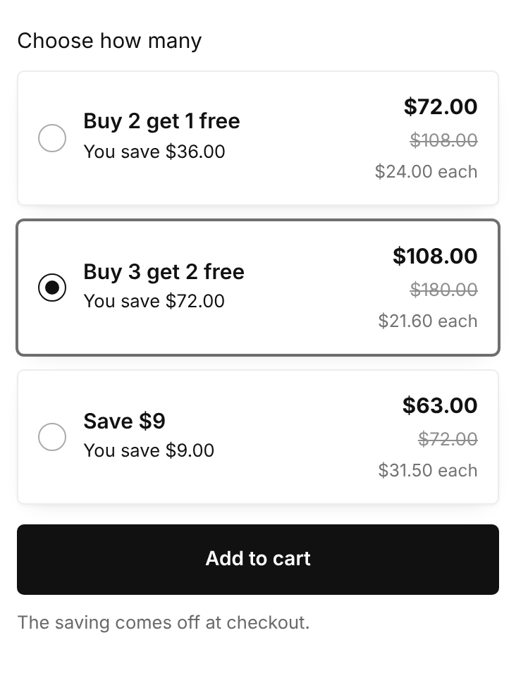
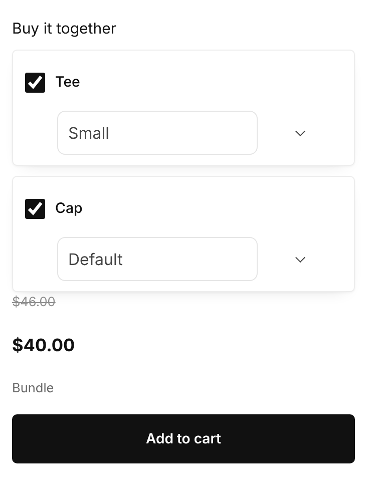
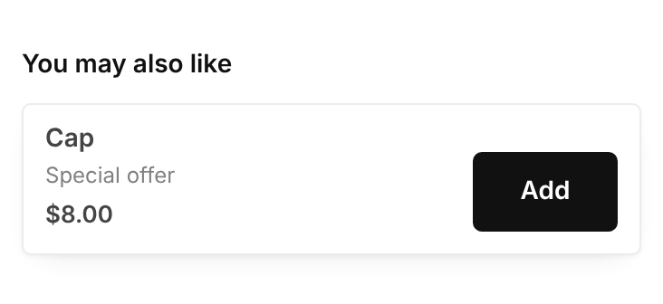

# Quantity offers, bundles and upsells in Materia

Materia has three blocks that sell more per order: **Quantity offer**, **Bundle** and **Upsell Pro**. They work in Main product (the product page), Featured product (any page), as standalone blocks, and they show up in the cart drawer, cart page and Storelib checkout.

The screenshots in this guide are the real blocks drawn by the theme with sample offers. Your colours, fonts and buttons follow your Theme settings.

---

## How the saving reaches checkout

Storelib prices the cart and checkout. The theme shows offers and adds the right items to the cart, but **it never grants a discount by itself**. A saving is taken off at checkout only when one of these exists:

1. **A Storelib offer** for that product, made in Storelib under **Products › Upsells and bundles** (a bundle, a quantity break, or a checkout offer).
2. **A discount code** set on the block, which the theme applies to the cart when the offer is added.

If neither exists, every item is charged at its normal price. The block still works as a quick way to add several items.

When a Storelib offer exists, the block reads it automatically (labels, quantities, savings) and the cart shows the real amounts Storelib confirms. Prices are always formatted in the visitor's currency and language.

---

## Quantity offer

Lets the shopper pick how many to buy, with a saving per tier: quantity breaks (2 for less, 3 for even less) and Buy X Get Y (buy 2, get 1 free).

### Set it up

1. In Storelib, open **Products › Upsells and bundles** and create a **quantity break** for the product. Add its tiers, for example *Buy 2 get 1 free* and *Buy 3 get 2 free*.
2. In the website builder, open a product page, select **Main product** (or a **Featured product** section) and choose **Add block › Quantity offer**.
3. Under **Offer**, set **Tier quantities and discounts** to **StoreLib offers**. The tiers, labels and savings now come from Storelib.
4. Pick a **Style** and **Chosen at first** (the tier selected when the page opens).
5. Under **Button**, choose **Purchase buttons** (see *Purchase buttons* below).

### Without a Storelib offer

Set **Tier quantities and discounts** to **Theme tiers** and fill in each tier:

- **Quantity paid for** and **Free items**: *Buy 1 get 2 free* is paid 1, free 2 (adds 3 units). *Buy 2 get 3 free* is paid 2, free 3 (adds 5 units).
- **Label**, **Badge** (*Most popular*), optional **Tier image** and **caption**.
- **Discount code**: the code Storelib should apply for this tier. Without a code (or a Storelib offer), free items are charged.

The saving shown on a theme tier is only a label. Keep it the same as the discount the code gives.

### What the shopper sees

- Each tier shows the total, the full price crossed out (if **Show full price crossed out** is on) and the price per item.
- Picking a tier sets the quantity. Free units go in the same cart line as the paid ones, and Storelib marks them free.
- In the cart drawer the line shows Storelib's final price, with the original price crossed out when lower.

---

## Bundle

Sells this product together with up to three others you pick, added to the cart in one step.

### Set it up

1. In Storelib, open **Products › Upsells and bundles** and create a **bundle** with the same products. This is what makes checkout take the saving off.
2. In the builder, add **Bundle** to Main product or Featured product.
3. Under **Products**, pick **Product 1–3** (the current product is always included).
4. Under **Saving**:
   - If a Storelib bundle matches, the block shows its saving by itself.
   - Otherwise, set **Saving shown** and a **Discount code**, and keep the two consistent.
5. Choose **Style**, **Show pictures** and **Show compare at prices**.

### What the shopper sees

- Each product can be ticked or unticked, with its own option picker (size, colour).
- The total updates as items are ticked. With every item ticked and a matching Storelib bundle, the bundle price shows.
- **Add to cart** adds every ticked item in one request. If **Open the cart after adding** is on, the cart drawer opens on the new lines.

---

## Upsell Pro

Shows other products to add next to this one, each with its own Add button, or with checkboxes when it shares the main buttons.

### Set it up

1. In the builder, add **Upsell Pro** to Main product or Featured product.
2. Under **Products**, choose **Product source**:
   - **Picked**: only the products you choose.
   - **Picked, then recommended**: your picks first, then related products up to the maximum.
3. Items are added at their own price. For a special upsell price, create a **checkout offer** in Storelib under **Products › Upsells and bundles**, or set a discount code. The offer's label (*Special offer*) and price then show on the card.

Related blocks work the same way: **Pair With upsell** (with Include checkboxes) and **cart recommendations** in the cart drawer.

---

## Purchase buttons

Every offer block has **Purchase buttons** under **Button**:

| Option | What it does |
| --- | --- |
| **Block button** (default) | The block has its own Add to cart. The main product buttons stay separate. |
| **Main buttons** | The block's button is hidden. The product's own **Add to cart** and **Buy now** add the main item and the block's selection together. |
| **Both** | Keeps the block's button and also includes the selection in the main buttons. |

With **Main buttons**:

- The selected variant, the chosen tier or bundle set and any ticked upsells are added in one request.
- The same item is never added twice.
- **Buy now** adds the selection first, then goes to checkout. Anything already in the cart goes to checkout too.
- Required cart terms are never ticked for the shopper; the drawer opens so they can confirm.

Hiding the block button alone does not add its selection to the main buttons. Choose **Main buttons** for that.

---

## Personalisation and required fields

If the product has custom fields (text, image upload), the offer buttons check them first. Uploaded images go through Storelib's upload and travel with the line to checkout. Underscore properties (`_sl_offer_id` and similar) are kept for Storelib's reports and are not shown to the shopper.

---

## Currency and language

- Totals and per-item prices use the theme's money format, so they follow the visitor's currency and language.
- When a visitor shops in another currency (a market), tiers with a fixed amount show their label instead of a converted amount. Storelib's cart then shows the exact converted price.

---

## Troubleshooting

| What you see | Why, and what to do |
| --- | --- |
| The saving shows on the product page but not at checkout | No Storelib offer and no valid discount code. Create the offer under **Products › Upsells and bundles**, or set a working **Discount code** on the block. |
| Free items are charged | Same cause. *Free items* only adds units; Storelib makes them free. |
| The block shows nothing on the store | Tier source is **StoreLib offers** but the product has no active quantity break. Create one, or switch to **Theme tiers**. |
| Two offers compete in the cart | Storelib picks the offer that applies at checkout. The cart shows the saving it actually gives. |
| "Not enough stock" or a similar message after Add | Storelib refused the request (stock or per-order limit). The message stays on the block; nothing was added. |
| A change doesn't show in the builder after a push | Reload the builder tab. Changes are drafts until you press **Publish**. |

---

## Before you publish

These blocks are tested in the theme with sample offers. Before publishing, place one real test order:

1. a quantity tier with free items,
2. a full bundle,
3. an upsell with a checkout offer.

Check that the checkout total matches the cart drawer.
